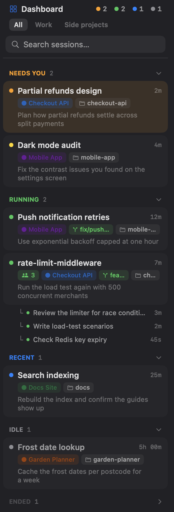

<div align="center">

# cmux Dashboard

**Every coding agent running in [cmux](https://cmux.com), sorted by what needs you.**

[](#quick-start) [](https://cmux.com) [](./LICENSE) [](https://agentlayer.one)

One file. No setup, no network, no background process.

</div>

---

<table>
<tr>
<td width="300" valign="top">



</td>
<td valign="top">

### At a glance

Every Claude Code and Codex session across all your workspaces, one card each, sorted into what you should look at next:

🟠 **Needs you**: waiting on your input<br>
🟡 **Needs you**: finished a turn you haven't seen<br>
🟢 **Running**: working, or a subagent still is<br>
🔵 **Recent**: went idle in the last hour<br>
⚪ **Idle**: quiet for over an hour<br>
▸ **Ended**: ended in the last day, folded away

### On each card

- **Click to jump** straight to that session's tab
- **Time in state**: how long it's been working, waiting or idle
- **Workspace, branch and folder** at a glance
- **Your last prompt**, so you remember what you asked
- **Subagents** listed under the session that started them

### Find things fast

- **Search** by title, prompt, workspace, group, folder or branch
- **Group chips** to show one workspace group at a time

</td>
</tr>
</table>

---

## Quick start

You need macOS and the [cmux](https://cmux.com) app, version 0.65.2 or newer, with Custom Sidebars turned on (they are by default). Agents show up once they run in cmux terminals with cmux's hooks (`cmux hooks setup`).

**1. Download the dashboard** into cmux's sidebar folder:

```sh
mkdir -p ~/.config/cmux/sidebars && curl -fsSL https://raw.githubusercontent.com/AgentLayer1/cmux-custom-dashboard/main/dist/dashboard.js -o ~/.config/cmux/sidebars/dashboard.js
```

**2. Open it**, as a panel on the right or as a tab:

```sh
cmux right-sidebar set custom dashboard
cmux sidebar open dashboard
```

That's it. To update, run the same `curl` again; cmux reloads the sidebar on its own.

<details>
<summary><b>3. Optional: a one-click toolbar button</b></summary>

<br>

Add an action and a tab-bar button to `~/.config/cmux/cmux.json` (back the file up first):

```json
{
  "actions": {
    "dashboard": {
      "type": "command",
      "title": "Dashboard",
      "icon": { "type": "symbol", "name": "square.grid.2x2" },
      "command": "cmux right-sidebar set custom dashboard && exit",
      "target": "newTabInCurrentPane"
    }
  },
  "ui": {
    "surfaceTabBar": {
      "buttons": ["cmux.newTerminal", "cmux.splitRight", "cmux.splitDown", "dashboard"]
    }
  }
}
```

The command runs in a new terminal tab, and `exit` closes that tab once the panel is open. `buttons` lists every button the tab bar shows, so keep the ones you already have and put `"dashboard"` where you want it. Then apply it without restarting:

```sh
cmux reload-config
```

</details>

---

## Development

Written in TypeScript and tested on cmux's own sidebar runtime. You need [Bun](https://bun.sh) and cmux; run `bun install` once.

| Command | Does |
|---|---|
| `bun run install:cmux` | Checks, then installs into cmux, but only after cmux validates it. A failure leaves your installed dashboard alone. |
| `bun run check` | Typecheck, build and tests. |
| `bun run build` | Compiles [`src/dashboard.ts`](./src/dashboard.ts) to [`dist/dashboard.js`](./dist/dashboard.js). |
| `bun run test` | Tests only. |
| `bun run typecheck` | Typecheck only. |
| `bun run preview` | Builds `dashboard-preview`, the dashboard drawing made-up sessions. |

<details>
<summary><b>How the build works</b></summary>

<br>

[`src/dashboard.ts`](./src/dashboard.ts) is the source of truth. The build only erases types: `erasableSyntaxOnly` rejects any TypeScript that would need code generated, and the target matches the source, so `dist/dashboard.js` is the source minus its types, comments kept. It's committed so people can download it, and a test fails when it falls behind the source.

The build sees only [`src/runtime.d.ts`](./src/runtime.d.ts), not Bun's or Node's types, so the dashboard can't reach for an API cmux's runtime doesn't have.

</details>

<details>
<summary><b>Versions</b></summary>

<br>

The file's header carries a version and build, such as `v0.1.1 (4)`:

- **Build** goes up by one every time a change is installed.
- **Version** follows [semver](https://semver.org) for changes someone using the dashboard would notice.

To see which one you have installed:

```sh
grep -m1 "cmux Dashboard · v" ~/.config/cmux/sidebars/dashboard.js
```

</details>

<details>
<summary><b>Tests</b></summary>

<br>

[`src/dashboard.test.ts`](./src/dashboard.test.ts) runs the built `dist/dashboard.js`, the file people install, on cmux's own sidebar runtime. It rebuilds the scene from the operations the runtime sends to the app and taps it the way cmux does.

cmux's runtime is GPL-licensed, so it isn't copied into this repo. The tests load `SidebarRuntime.js` from the installed app, at `/Applications/cmux.app/Contents/Resources/CmuxSwiftRenderUI_CmuxSwiftRenderUI.bundle/Contents/Resources/`. Set `CMUX_SIDEBAR_RUNTIME` to test against a different copy.

</details>

<details>
<summary><b>Preview with mock data</b></summary>

<br>

[`preview/fixture.ts`](./preview/fixture.ts) holds invented workspaces and sessions covering every section, with a frozen clock. `bun run preview` wraps the real dashboard so it draws the fixture instead of your sessions, and writes it to `~/.config/cmux/sidebars/dashboard-preview.js` (pass a path to write it elsewhere). Taps do nothing in the preview. It's how the screenshot above is made:

```sh
bun run preview && cmux right-sidebar set custom dashboard-preview
cmux shot --out assets/screenshot-full.png        # then crop the panel into assets/screenshot.png
rm ~/.config/cmux/sidebars/dashboard-preview.js && cmux right-sidebar set custom dashboard
```

</details>

<details>
<summary><b>Keeping <code>runtime.d.ts</code> current</b></summary>

<br>

cmux publishes no types for custom sidebars, so [`src/runtime.d.ts`](./src/runtime.d.ts) is written by hand. Its header names the cmux version it matches and the three cmux sources it follows:

| Part | Source in [cmux](https://github.com/manaflow-ai/cmux) |
|---|---|
| Runtime API: `signal`, `computed`, `sidebar`, `cmux`, views and modifiers | `Packages/macOS/CmuxSwiftRenderUI/Sources/CmuxSwiftRenderUI/Resources/SidebarRuntime.js` (also shipped inside the app) |
| Data shape: `workspaces`, `agents`, `children`, `tabs`, `groups`, `clock` | `Packages/macOS/CmuxSidebar/Sources/CmuxSidebar/Layout/CustomSidebarDataContextBuilder.swift` |
| What each field means and when it's present | `docs/custom-sidebars.md` |

After a cmux release, diff those paths between the release tags in a cmux checkout, mirror any change in `runtime.d.ts`, update the version in its header, and run `bun run check`. The typecheck then points at any dashboard or fixture code the change breaks.

```sh
git -C <cmux checkout> fetch --tags && git -C <cmux checkout> diff v0.65.2.2 v<new> -- Packages/macOS/CmuxSwiftRenderUI/Sources/CmuxSwiftRenderUI/Resources/SidebarRuntime.js Packages/macOS/CmuxSidebar/Sources/CmuxSidebar/Layout/CustomSidebarDataContextBuilder.swift docs/custom-sidebars.md
```

</details>

---

<details>
<summary><b>Known limits</b></summary>

<br>

These come from the data cmux gives custom sidebars, not from the dashboard. Checked against cmux 0.65.2.

| | Limit | cmux issue |
|:---:|---|---|
| 🟡 | **A finished session can stay in Running.** When Claude Code's Stop hook doesn't fire (an Esc interrupt, a timed-out hook), cmux's built-in sidebar settles the session but `agents[].status` keeps saying it's working. | [#39157](https://github.com/manaflow-ai/cmux/issues/39157) |
| 🟡 | **`agents[].surfaceId` can't focus a tab.** The dashboard focuses through the hosting tab's `tabs[k].surfaceId` instead, so clicking a card works today. | [#39154](https://github.com/manaflow-ai/cmux/issues/39154) |
| ✅ | **No group chips in the right-hand panel.** cmux 0.65.2 doesn't pass workspace groups there; they show in the left sidebar and as a tab. | [#20281](https://github.com/manaflow-ai/cmux/issues/20281) |
| ✅ | **Background subagents drop off when the turn ends**, even while they keep running. | [#20283](https://github.com/manaflow-ai/cmux/issues/20283) |

🟡 open in cmux &nbsp;·&nbsp; ✅ fixed on cmux `main`, waiting for a release

</details>

---

<div align="center">

[MIT](./LICENSE) © [AgentLayer](https://agentlayer.one)

</div>
