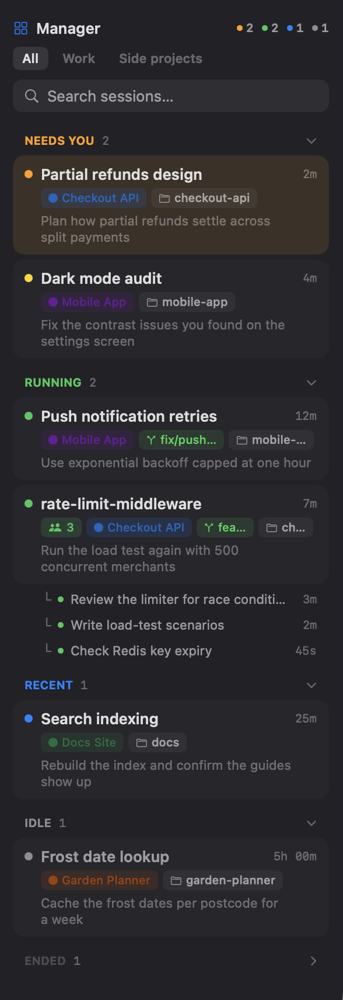

<div align="center">

# cmux Manager

**Every coding agent running in [cmux](https://cmux.com), sorted by what needs you.**

[](#quick-start) [](https://cmux.com) [](./LICENSE) [](https://agentlayer.one)

One file. No setup, no network, no background process. Part of [AgentLayer's workstation guide](https://agentlayer.one/docs/workstation/cmux#agent-dashboard).

</div>

---

<table>
<tr>
<td width="350" valign="top">



</td>
<td valign="top">

### At a glance

Every Claude Code and Codex session across all your workspaces, one card each, sorted into what you should look at next:

🟠 **Needs you**: waiting on your input<br>
🟡 **Needs you**: finished a turn you haven't seen<br>
🟢 **Running**: working, or a subagent still is<br>
🔵 **Recent**: went idle in the last hour<br>
⚪ **Idle**: quiet for over an hour<br>
▸ **Ended**: ended in the last day, folded away

### On each card

- **Click to jump** straight to that session's tab
- **Time in state**: how long it's been working, waiting or idle
- **Workspace, branch and folder** at a glance
- **Your last prompt**, so you remember what you asked
- **Subagents** listed under the session that started them

### Find things fast

- **Search** by title, prompt, workspace, group, folder or branch
- **Group chips** to show one workspace group at a time

</td>
</tr>
</table>

---

## Quick start

You need macOS and the [cmux](https://cmux.com) app, version 0.65.2 or newer, with Custom Sidebars turned on (they are by default). Agents show up once they run in cmux terminals with cmux's hooks (`cmux hooks setup`).

**1. Download the manager** into cmux's sidebar folder:

```sh
mkdir -p ~/.config/cmux/sidebars && curl -fsSL https://raw.githubusercontent.com/AgentLayer1/cmux-custom-manager/main/dist/manager.js -o ~/.config/cmux/sidebars/manager.js
```

**2. Open it**, as a panel on the right or as a tab:

```sh
cmux right-sidebar set custom manager
cmux sidebar open manager
```

That's it. To update, run the same `curl` again; cmux reloads the sidebar on its own.

Coming from **cmux Dashboard** (this project's name before v0.3.0)? Run step 1, then `rm ~/.config/cmux/sidebars/dashboard.js`, and point any `right-sidebar set custom dashboard` button or command at `manager`.

<details>
<summary><b>3. Optional: a one-click toolbar button</b></summary>

<br>

Add an action and a tab-bar button to `~/.config/cmux/cmux.json` (back the file up first):

```json
{
  "actions": {
    "manager": {
      "type": "command",
      "title": "Manager",
      "icon": { "type": "symbol", "name": "square.grid.2x2" },
      "command": "cmux right-sidebar set custom manager && exit",
      "target": "newTabInCurrentPane"
    }
  },
  "ui": {
    "surfaceTabBar": {
      "buttons": ["cmux.newTerminal", "cmux.splitRight", "cmux.splitDown", "manager"]
    }
  }
}
```

The command runs in a new terminal tab, and `exit` closes that tab once the panel is open. `buttons` lists every button the tab bar shows, so keep the ones you already have and put `"manager"` where you want it. Then apply it without restarting:

```sh
cmux reload-config
```

</details>

---

## Use it in your own sidebar

Building a custom sidebar of your own? Add this repo from GitHub and bundle it into your sidebar with Bun:

```sh
bun add github:AgentLayer1/cmux-custom-manager
```

That installs `main`, and `bun.lock` records the exact commit. To move to the latest `main` later, run `bun update cmux-custom-manager`.

Take whichever level you need:

| Import | Gives you |
|---|---|
| `cmux-custom-manager/model` | `agentCards` (every session as a card, placed in its section), `bySection`, `jump` to focus a session, and cmux's types |
| `cmux-custom-manager/components` | `cardRow`, `subagentRow`, `sectionHeader` and `tally` (for a manager section by name, or a look of your own: label, colour, icon), `chip`, `searchField`, `badge` |
| `cmux-custom-manager/manager` | `manager()`, the whole panel, with its own search and filters each time it's mounted. `manager({ header })` draws your view (your tabs, say) in place of its icon and title, beside the tallies, `trailing` ends the row after them (a reload button, say), and `sections` adds sections of your own above Needs you |
| `cmux-custom-manager/sections` | The types for `sections`: `HostSection` and `SectionCard` |

[`examples/host.ts`](./examples/host.ts) puts all three to work: a two-page sidebar whose Today page draws a "Needs you" strip from the model and the card component, and whose Agents page is the whole manager, with the host's page tabs in its header row and two sections of its own above Needs you.

Each of your `sections` is drawn like the manager's own, in the order you list them: an icon, a label and a count, folding from its header, tallied in the header row before the manager's sections, and hidden while its count is 0. A section holds cards the manager draws, or your own view:

```ts
manager({
  sections: [
    { label: "QUEUE", icon: "tray.full.fill", color: "#BF5AF2", cards },             // cards, the first one expanded
    { label: "NOTES", icon: "note.text", color: "#8E8E93", folded: true, count, content }, // your own view
  ],
});
```

`cards` returns `SectionCard`s, drawn like session cards: a dot, the title and a `span` (an estimate, say), the `badges` under it, and the `body` you give it while the card is expanded (your buttons go there). One card is expanded at a time; when it leaves the list, the next one opens, unless `expandFirst: false` starts every card closed. The search box matches a card's title, badges and `searchText`, and the count follows the cards shown unless you pass your own. `folded: true` starts any section folded.

---

## Development

Written in TypeScript and tested on cmux's own sidebar runtime. You need [Bun](https://bun.sh) and cmux; run `bun install` once.

| Command | Does |
|---|---|
| `bun run install:cmux` | Checks, then installs into cmux, but only after cmux validates it. A failure leaves your installed manager alone. Run it from a cmux terminal, where the `cmux` command is on your PATH. |
| `bun run check` | Typecheck, build and tests. |
| `bun run build` | Bundles [`src/main.ts`](./src/main.ts) into [`dist/manager.js`](./dist/manager.js). |
| `bun run test` | Tests only. |
| `bun run typecheck` | Typecheck only. |
| `bun run preview` | Builds `manager-preview`, the manager drawing made-up sessions. |
| `bun run screenshot` | Retakes `assets/screenshot.png`: the preview in a window of its own, cropped to the panel. |

<details>
<summary><b>How the build works</b></summary>

<br>

`src/` is the source of truth, in three layers a sidebar can import: [`model.ts`](./src/model.ts) (the agent data), [`components.ts`](./src/components.ts) (the rows and controls) and [`manager.ts`](./src/manager.ts) (the whole panel). [`main.ts`](./src/main.ts) carries the header and mounts the panel.

cmux loads one script, so [`scripts/build.ts`](./scripts/build.ts) bundles `main.ts` with Bun into `dist/manager.js`, headed by `main.ts`'s comment. The bundle is readable but drops the other comments; they stay in `src/`. It's committed so people can download it, and a test fails when it falls behind the source.

Before bundling, the build typechecks against only [`src/runtime.d.ts`](./src/runtime.d.ts), not Bun's or Node's types, so the manager can't reach for an API cmux's runtime doesn't have.

</details>

<details>
<summary><b>Versions</b></summary>

<br>

The file's header carries a version and build, such as `v0.1.1 (4)`:

- **Build** goes up by one every time a change is installed.
- **Version** follows [semver](https://semver.org) for changes someone using the manager would notice.

To see which one you have installed:

```sh
grep -m1 "cmux Manager · v" ~/.config/cmux/sidebars/manager.js
```

</details>

<details>
<summary><b>Tests</b></summary>

<br>

[`src/manager.test.ts`](./src/manager.test.ts) runs the built `dist/manager.js`, the file people install, on cmux's own sidebar runtime. It rebuilds the scene from the operations the runtime sends to the app and taps it the way cmux does.

cmux's runtime is GPL-licensed, so it isn't copied into this repo. The tests load `SidebarRuntime.js` from the installed app, at `/Applications/cmux.app/Contents/Resources/CmuxSwiftRenderUI_CmuxSwiftRenderUI.bundle/Contents/Resources/`. Set `CMUX_SIDEBAR_RUNTIME` to test against a different copy.

</details>

<details>
<summary><b>Preview with mock data</b></summary>

<br>

[`preview/fixture.ts`](./preview/fixture.ts) holds invented workspaces and sessions covering every section, with a frozen clock. `bun run preview` wraps the real manager so it draws the fixture instead of your sessions, and writes it to `~/.config/cmux/sidebars/manager-preview.js` (pass a path to write it elsewhere). Taps do nothing in the preview.

`bun run screenshot` makes the screenshot above from it, from a terminal inside cmux (its CLI answers nowhere else):

```sh
bun run screenshot
```

It opens a window of its own, shows the preview in that window's right sidebar, captures that window, crops it to the panel and writes `assets/screenshot.png`, then closes the window. Every command after the first names that window, so your own windows, workspaces and sidebars are never touched.

</details>

<details>
<summary><b>Keeping <code>runtime.d.ts</code> current</b></summary>

<br>

cmux publishes no types for custom sidebars, so [`src/runtime.d.ts`](./src/runtime.d.ts) is written by hand. Its header names the cmux version it matches and the three cmux sources it follows:

| Part | Source in [cmux](https://github.com/manaflow-ai/cmux) |
|---|---|
| Runtime API: `signal`, `computed`, `sidebar`, `cmux`, views and modifiers | `Packages/macOS/CmuxSwiftRenderUI/Sources/CmuxSwiftRenderUI/Resources/SidebarRuntime.js` (also shipped inside the app) |
| Data shape: `workspaces`, `agents`, `children`, `tabs`, `groups`, `clock` | `Packages/macOS/CmuxSidebar/Sources/CmuxSidebar/Layout/CustomSidebarDataContextBuilder.swift` |
| What each field means and when it's present | `docs/custom-sidebars.md` |

After a cmux release, diff those paths between the release tags in a cmux checkout, mirror any change in `runtime.d.ts`, update the version in its header, and run `bun run check`. The typecheck then points at any manager or fixture code the change breaks.

```sh
git -C <cmux checkout> fetch --tags && git -C <cmux checkout> diff v0.65.2.2 v<new> -- Packages/macOS/CmuxSwiftRenderUI/Sources/CmuxSwiftRenderUI/Resources/SidebarRuntime.js Packages/macOS/CmuxSidebar/Sources/CmuxSidebar/Layout/CustomSidebarDataContextBuilder.swift docs/custom-sidebars.md
```

</details>

<details>
<summary><b>Known limits</b></summary>

<br>

These come from the data cmux gives custom sidebars, not from the manager. Checked against cmux 0.65.2.

| | Limit | cmux issue |
|:---:|---|---|
| 🟡 | **A finished session can stay in Running.** When Claude Code's Stop hook doesn't fire (an Esc interrupt, a timed-out hook), cmux's built-in sidebar settles the session but `agents[].status` keeps saying it's working. | [#39157](https://github.com/manaflow-ai/cmux/issues/39157) |
| 🟡 | **`agents[].surfaceId` can't focus a tab.** The manager focuses through the hosting tab's `tabs[k].surfaceId` instead, so clicking a card works today. | [#39154](https://github.com/manaflow-ai/cmux/issues/39154) |
| ✅ | **No group chips in the right-hand panel.** cmux 0.65.2 doesn't pass workspace groups there; they show in the left sidebar and as a tab. | [#20281](https://github.com/manaflow-ai/cmux/issues/20281) |
| ✅ | **Background subagents drop off when the turn ends**, even while they keep running. | [#20283](https://github.com/manaflow-ai/cmux/issues/20283) |

🟡 open in cmux &nbsp;·&nbsp; ✅ fixed on cmux `main`, waiting for a release

</details>

---

<div align="center">

[MIT](./LICENSE) © [AgentLayer](https://agentlayer.one)

</div>
